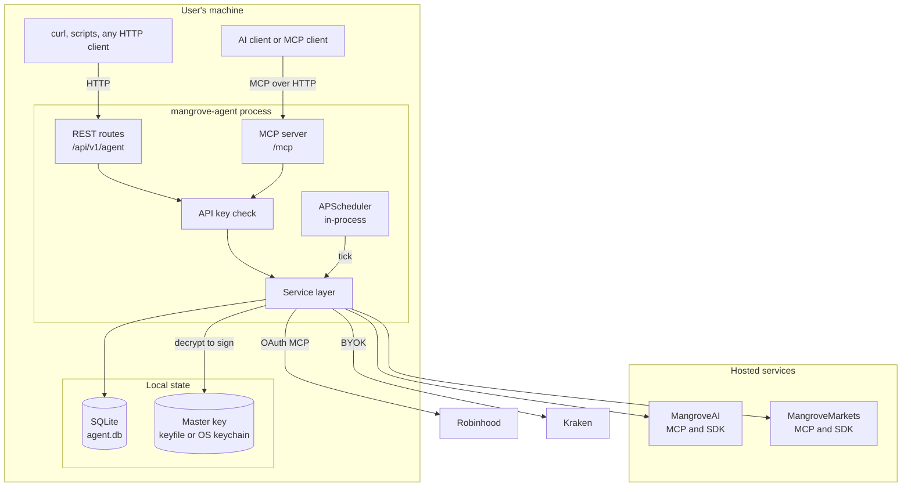
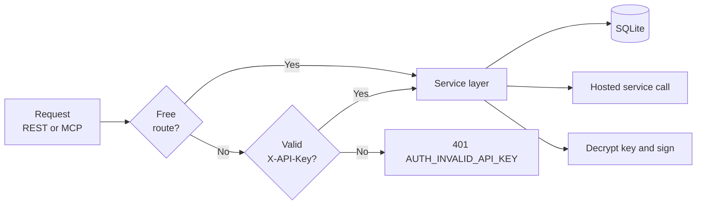
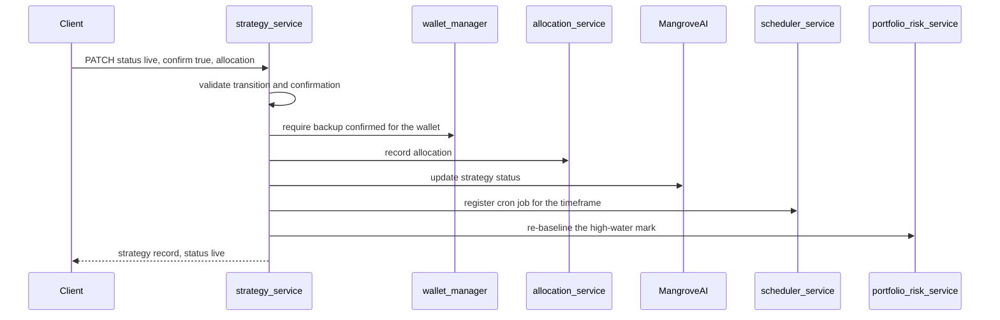
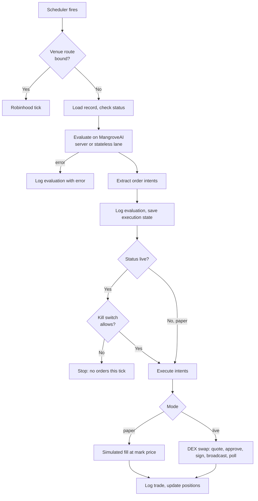

# Architecture

mangrove-agent is a local service that gives an AI client safe access to trading. It runs on
the user's own machine, holds the user's wallet keys, runs scheduled evaluations and logs
everything it does. Research, strategy building and strategy evaluation happen in Mangrove's
hosted services; the agent keeps only what has to be local.

The design follows four rules:

- **One process.** A single FastAPI app serves REST, MCP and OpenAPI, and runs the scheduler.
  The process must run as one worker, because the secret vault and the scheduler are
  per-process state.
- **One datastore.** SQLite holds business data, the scheduler's job store and the payment
  ledger in one database file.
- **Hosted services do the thinking.** Strategy evaluation, signals, risk gates, position
  sizing and cooldowns live in MangroveAI. The agent calls them and executes what comes back.
  It does not reimplement that logic.
- **The agent controls the money.** Keys, signing, confirmations, allocations and spending
  limits are enforced locally, in code the user can read.

## System overview



### Components

| Component | Responsibility |
|-----------|----------------|
| REST routes (`api/routes/`) | HTTP handlers under `/api/v1/agent`; delegate to services |
| MCP server (`mcp/`) | Local tools, plus forwarding of Markets and MangroveAI tools; served at `/mcp` over stateless Streamable HTTP |
| Auth (`shared/auth/`) | Checks `X-API-Key` against the configured `API_KEYS`; discovery routes are free |
| Services (`services/`) | Orchestration: wallets, execution, scheduling, logging, payments, venues |
| Scheduler | APScheduler `BackgroundScheduler` with a SQLAlchemy job store in the same SQLite file |
| SQLite | Wallets (encrypted), execution records, allocations, evaluations, trades, positions, schedules, payment ledger, venue orders |
| Master key | Encrypts wallet secrets; held in a keyfile or the OS keychain, never in the database |
| MangroveAI | Strategies, backtests, signals, market data, evaluation, knowledge base |
| MangroveMarkets | DEX quotes, routing, portfolio reads and marketplace actions |

Services are protocol-agnostic. REST routes and MCP tools call the same service functions, so
a capability has one implementation. Auth is enforced once, at the boundary.

## Where tools come from

The MCP server presents one catalog built from three sources:

1. **Local tools** are registered in `server/src/mcp/`. They cover wallets, swaps, Kraken,
   Robinhood venue control, paper schedules, marketplace approvals, the spend budget and
   discovery.
2. **MangroveMarkets tools** (`marketplace_*`, `dex_*`, `oneinch_*`, `wallet_*`) are read from
   the configured Markets server and wrapped with local authentication and wallet
   coordination. Tools that would sign or pay only prepare an approval preview.
3. **MangroveAI tools** are read from MangroveAI's MCP `tools/list` and forwarded unchanged.
   The agent keeps no copy of them, so new upstream tools appear without a code change.

[MCP contracts](mcp-contracts.md) describes the ownership split and how the agent's own tools
are kept stable.

## Request path



REST routes check the key with a FastAPI dependency. The MCP mount copies the `X-API-Key`
header into a context variable, so tools authenticate whether the client sends the header
or passes `api_key` as an argument. A valid key also bypasses the x402 payment middleware
on payment-gated routes.

## Strategy execution

The agent runs scheduled evaluations for two kinds of strategy:

- **Server-owned paper execution** of a MangroveAI strategy. MangroveAI keeps the balances,
  positions and trades; the agent supplies the clock. See
  [Paper schedules](#paper-schedules).
- **Local execution records**, which the agent can run on a cron schedule in `paper` or
  `live` status. The agent keeps its own trade, position and allocation records for these.
  The agent's API does not create them; the lifecycle, scheduler and execution machinery
  operate on records already in the local database.

Strategy creation, backtesting and validation always happen in MangroveAI. A client loads
MangroveAI's `strategy-composition` skill with `load_skill`, then uses MangroveAI tools such
as `build_strategy_for_regime`, `save_strategy`, `run_backtest` and `get_backtest`. The local
`POST /strategies/autonomous` and `/strategies/manual` routes return 410.

The diagram below shows one live tick end to end. The local scheduler fires the strategy's
job, the agent asks MangroveAI for an evaluation, and any order intents pass the portfolio kill
switch before the execution adapter acts on them. Robinhood orders go through Robinhood's
official MCP server with the agent's own OAuth grant, and a reconciliation job records only
confirmed fills. DEX swaps are quoted and prepared by MangroveMarkets, signed on this machine
under the 1inch-only signing guard, and broadcast by MangroveMarkets. Server-owned paper
schedules are not shown; they place no orders.



The diagram source is [diagrams/mangrove-live-execution.mmd](diagrams/mangrove-live-execution.mmd).
Re-render it with Mermaid CLI 11 or later, which supports the ELK layout it uses.

### Lifecycle and activation

A local record has one of five statuses, changed only through
`PATCH /api/v1/agent/strategies/{id}/status`. Allowed moves are `draft` to `inactive` or
`archived`; `inactive` to `paper`, `live` or `archived`; `paper` to `live`, `inactive` or
`archived`; `live` to `inactive` or `archived`. `archived` is final.



- Moving to `live`, or leaving it, requires `confirm: true`.
- Moving to `live` requires an allocation (wallet, token, amount, `slippage_pct`) and a
  wallet whose backup the user has confirmed. A strategy bound to a Robinhood venue uses its
  venue mandate instead of a wallet allocation.
- `paper` and `live` register a cron job named `eval-<strategy_id>`. Any other status cancels
  it. Leaving `live` also releases the allocation.
- Any change into or out of `live` re-baselines the portfolio high-water mark, so a deliberate
  change in the live set is not read as drawdown.

After activation the scheduler fires on the strategy's timeframe with no further client
involvement.

### Scheduler

The scheduler runs inside the app process and shares the SQLite file as its job store, so jobs
survive restarts. Jobs use a ten-thread pool, `coalesce=True` (a missed run is caught up once,
not repeatedly), `max_instances=1` and a 60-second misfire grace time. Ticks run in worker
threads and never block REST or MCP requests.

| Job | Schedule | Purpose |
|-----|----------|---------|
| `eval-<strategy_id>` | Cron per timeframe: `1m`, `5m`, `15m` every N minutes; `1h` at minute 0; `4h` at minute 0 every 4 hours; `1d` at 00:00 | Evaluate one local `paper` or `live` record |
| `paper-dispatch` | Every 5 seconds | Start due paper-schedule evaluations (up to four at once) |
| `broker-reconciliation` | Every 15 seconds | Reconcile pending Robinhood orders; does nothing when none are pending |
| `x402-reconciliation` | Every 15 seconds | Check outstanding payment authorizations against chain data; registered only when a reconciliation RPC URL is configured |
| `x402-refunds` | Every 30 seconds | Verify refunds against chain data; registered only when a reconciliation RPC URL is configured |

Schedules fire only while the process runs. Closing the machine or stopping the agent stops
evaluation.

### Evaluation lanes

Each local record evaluates in one of two lanes, stored in its `evaluation_lane` column. A
record without an explicit lane uses `server`.

- **`server`**: the agent asks MangroveAI to evaluate the saved strategy by ID, with
  `persist=True` for both paper and live. MangroveAI's database is authoritative for the
  strategy's execution state and open positions.
- **`stateless`**: the agent sends the full strategy definition with its own saved
  `execution_state` and open positions, and MangroveAI writes nothing server-side
  (`persist=False`). The agent stores the returned state and echoes it on the next tick.
  Robinhood-bound strategies always use this lane.

In both lanes the agent keeps its own record of evaluations, trades and positions.

### The evaluation tick



MangroveAI returns new orders with the evaluation. The agent turns each `filled` engine order
into an order intent (action, side, symbol, asset-unit amount, reference price, stop and
take-profit levels). Orders that are only resting, such as a pending stop-loss bracket, are
logged and skipped, so a position is not exited the moment it opens. An order that cannot be
mapped is skipped with a logged warning and never silently dropped.

Execution of the intents goes through `order_executor`, the single path for every swap:

- **Paper** fetches the current mark price from MangroveAI and records a simulated trade at
  that price. No wallet is involved.
- **Live** requires a wallet allocation and a backup-confirmed wallet. It runs the DEX swap
  described in [Swaps](#swaps), using the allocation's wallet, chain and slippage tolerance,
  and caps the input-token spend at the allocation amount.
- After each fill the agent opens or closes a local position and sets the profit and loss on
  exit trades.

A failure on one intent is logged and does not stop the rest. A failure of the evaluation
call itself is recorded as an evaluation with `status: error`; the strategy stays active and
the next tick tries again.

### Paper schedules

Server-owned paper execution lets MangroveAI own the saved strategy, balances and positions
while the agent supplies the clock. See [Paper scheduling](paper-scheduling.md).

- A schedule is scoped to the current upstream identity (API key or payer wallet) and a
  strategy, and is bounded by an interval and a maximum evaluation count.
- Starting one needs `confirm=true`, because every evaluation can incur API or x402 cost.
- `paper-dispatch` runs every five seconds and starts a tick when a schedule's current time
  slot has not yet been evaluated. Slots are `time // interval_seconds`, so a restart never
  repeats a slot.
- The agent records a pending slot before calling MangroveAI. If the outcome is unknown the
  schedule moves to `attention` and stops until `agent_reconcile_paper_schedule` retries the
  same slot, so one slot is never evaluated or paid for twice.
- Schedules are stored in the `paper_schedules` table and survive restarts.

### Swaps

User-initiated swaps and strategy-driven swaps share one execution path. The `/dex/swap`
route and the `execute_swap` tool build an order intent from the request and hand it to
`order_executor` in live mode.

1. Convert the human-unit amount to base units and fetch a quote.
2. If the token needs approval, sign the approval locally, broadcast it and poll until it
   confirms.
3. Prepare the swap, sign it locally and broadcast it.
4. Poll the transaction until it leaves `pending` or a 60-second timeout passes.
5. Log the trade and update positions.

The SDK never sees a key. Before signing, the agent requires a confirmed wallet backup and a
`slippage_pct` that is greater than 0 and at most `0.0025`. See
[Safety controls](#safety-controls).

### Robinhood execution

A strategy can be bound to a Robinhood execution venue with a capital mandate. The agent
evaluates it through MangroveAI's stateless lane, then submits the resulting intent to
Robinhood's MCP endpoint. Each tick reconciles pending orders first, checks the portfolio
kill switch, and allows at most one pending order per strategy. Order intents are stored
durably before submission, and an unknown submission outcome is marked `uncertain` and
reconciled rather than retried. See [Robinhood execution](robinhood-execution.md).

## Safety controls

These controls are enforced in the agent, independent of the AI client.

- **Keys stay local and out of the transcript.** `create_wallet` returns a `vault_token`, not
  a secret. The user reveals the secret with a local script that talks to the loopback REST
  API, so it never passes through MCP or a chat. Vault entries are single-read and expire.
- **Master key.** Wallet secrets are Fernet-encrypted. The key is read from `MASTER_KEY_PATH`
  (a keyfile with owner-only permissions), then the OS keychain; a missing key is generated
  into the keyfile only when none exists anywhere. The agent never invents a replacement for a
  key it cannot find.
- **Backup gate.** Live swaps, live strategy activation and x402 payments refuse a wallet
  until `confirm-backup` has recorded that the user saved its secret off the machine.
- **Signing guard.** The wallet manager signs only a call to a 1inch aggregation router, an
  ERC-20 `approve()` for a 1inch spender, and the narrow typed-data forms used for x402
  payment authorizations, marketplace proofs and Sign-In-With-X. EIP-7702 and blob
  transactions, authorization lists, and any other target are refused before the key is
  decrypted.
- **Explicit confirmation.** Swaps, going live, leaving live, starting a paper schedule,
  marketplace submission and spend top-ups each need `confirm=true`.
- **Slippage cap.** Swaps and allocations require an explicit tolerance of at most 0.25
  percent.
- **Portfolio kill switch.** See [the specification](specification.md#portfolio-kill-switch).
  Aggregate drawdown across live strategies past `PORTFOLIO_MAX_DRAWDOWN_PCT` (default 0.30)
  pauses every live strategy and latches until a human resets it.
- **x402 spend budget.** See [the specification](specification.md#x402-spend-budget). Every
  outbound payment is reserved against an agent-wide budget (default $25) before it is signed.
  When the budget is spent, payments stop until a human authorizes more.

## Outbound payments

The agent reaches MangroveAI and MangroveMarkets in one of two modes, chosen by configuration.
In API-key mode a configured Mangrove key authenticates every call. In wallet mode there is no
key, and priced calls are paid per request with x402 from the payer wallet named by
`X402_PAYER_WALLET`; the agent never picks a wallet on its own. An authentication failure never
switches modes or triggers a payment.

Each payment is signed locally as an EIP-3009 authorization, after the spend budget accepts
it. Payment attempts get a durable operation identity so a retry reuses the original payment
instead of paying twice. An unresolved authorization keeps its amount reserved, and a
background worker, when a chain RPC is configured, checks it against finalized chain data.
See [x402 payment uncertainty](x402-payment-uncertainty.md).

## Data

All state lives in one SQLite file (`DB_PATH`), opened in WAL mode with foreign keys on.
Migrations in `server/src/shared/db/migrations/` apply in filename order at startup. The
schema is described in the [specification](specification.md#sqlite-schema). The scheduler
creates its own job tables in the same file.

## Deployment

The agent is local-only. It binds the loopback interface because it holds wallet secrets.

- **Bare metal** (the default of `scripts/setup.sh`): a virtual environment, `uvicorn` on port
  9080, and the OS keychain or a keyfile for the master key.
- **Docker Compose** (`setup.sh --docker`, or `docker compose up -d --build`): the container
  listens on 8080 and is published on `127.0.0.1:9080`. State lives in the bind-mounted
  `./agent-data/` directory, which holds the database and the master keyfile. The container
  runs a single worker.

## Configuration

Configuration is per-environment JSON in `server/src/config/`. `ENVIRONMENT` selects the file
(`local`, `dev`, `test`, `prod`), and `configuration-keys.json` declares the required,
optional and full-app keys. For plugin installs, `MANGROVE_AGENT_HOME` moves the config, the
database and the master key out of the code directory so an update keeps them. See the
[configuration guide](configuration.md).

## Chain support

Wallets can be created or imported on EVM chains (Base mainnet, chain ID 8453, is the default)
and on XRPL. DEX swaps and strategy-driven live trading are EVM only and go through 1inch via
MangroveMarkets, whichever EVM chains that service supports. The signing guard pins x402
payments to USDC on Base mainnet and Base Sepolia.

## Code layout

```
mangrove-agent/
  .claude/                 Claude Code skills, rules and guardrail hooks
  scripts/                 Setup, secret handling, contract check, client launchers
  docs/                    Documentation
  tutorials/               Walkthrough curriculum
  docker-compose.yml
  server/
    Dockerfile
    src/
      app.py               FastAPI factory, lifespan, x402 middleware, /mcp mount
      config.py            Config loader
      config/              Per-environment JSON and configuration-keys.json
      health.py            /health payload
      api/
        router.py          Mounts routers under /api/v1/agent and /api/x402
        routes/            discovery, wallet, dex, cex, brokers, marketplace, strategies,
                           logs, portfolio, x402_spend, reference_strategies, hello_mangrove
      mcp/                 server.py, tools.py, broker_tools.py, paper_tools.py,
                           marketplace_tools.py, marketplace_proxy.py, mangrove_proxy.py,
                           registry.py, pricing_bindings.py
      services/            wallet_manager, strategy_service, order_executor,
                           scheduler_service, paper_schedule_service, trade_log,
                           allocation_service, portfolio_risk_service, spend_service,
                           x402_payer, payment_*, broker_*, robinhood_*, cex_*,
                           marketplace_*, dex_service, secret_vault, agent_identity
      models/domain.py     OrderIntent, Evaluation, Trade, Position, Allocation
      shared/              auth, clients (SDK singletons), crypto (Fernet), db (SQLite and
                           migrations), x402, errors, logging
    tests/                 unit, integration and e2e tests
```

## Technology

| Layer | Choice |
|-------|--------|
| Web framework | FastAPI |
| MCP | FastMCP (Streamable HTTP, stateless) |
| Storage | SQLite (WAL) |
| Scheduler | APScheduler with a SQLAlchemy job store |
| Key encryption | Fernet from `cryptography`, master key in a keyfile or OS keychain via `keyring` |
| Hosted-service clients | `mangroveai` and `mangrovemarkets` SDKs, plus MCP clients for MangroveAI, Markets and Robinhood |
| Payments | x402 with EIP-3009 authorizations in USDC |
| Tests | pytest |
