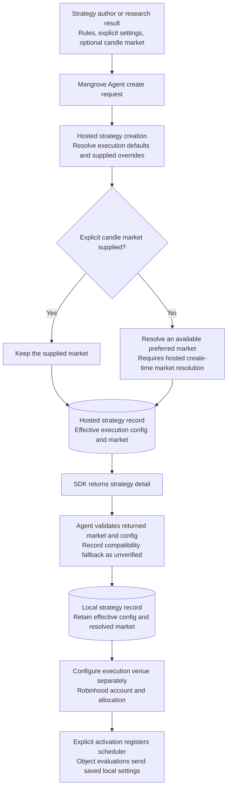

# Strategy creation, defaults, and saved markets

A strategy's candle market and execution venue are separate settings. The
candle market is `strategies.market_context_json` (`base_token`, `quote_token`,
`market_data_venue`). A Robinhood execution allocation is a separate
`broker_routes` row. Configuring Robinhood does not select a candle market.

## Creation and persistence

For a new row, an explicit requested market must agree with returned market
metadata. If an older server omits market metadata, the Agent keeps the explicit
request or leaves the market unresolved. It does not invent a local default.
Incomplete or conflicting returned market metadata is an error. Existing local
rows returned by deduplication are not rewritten.

## Where defaults come from

- **Research configuration:** a recovered strategy can supply its experiment's
  base execution config, sampled run overrides, and recorded candle market.
  These are explicit inputs, not newly selected platform defaults.
- **Hosted execution defaults:** MangroveAI's config service resolves the
  canonical `domains/ai_copilot/prompts/trading_defaults.json` together with
  caller overrides, sizing-model rules, constraints, and cadence-based cooldown
  defaults when no cooldown was authored. The effective create response is the
  source used for the new local record.
- **Agent compatibility defaults:** the Agent fetches
  `/api/v1/config/trading-defaults` through the SDK and caches it. If that fetch
  fails or is malformed, it uses its bundled v3.5.0 snapshot. Falling back to
  locally reconstructed execution settings does not prove parity with the
  server's saved configuration.
- **Default candle market:** the hosted resolver queries available instrument
  markets through MangroveRoots, then applies the preference order
  `BINANCE/USDC`, `KRAKEN/USD`, `KRAKEN/USDC`. It selects an available preferred
  market; this is not a Robinhood-specific rule or an unconditional Kraken
  default.

MangroveAI #1411 added create-time market resolution for bare-asset REST
creation. Older hosted versions save omitted market fields as null and resolve
an available market at evaluation time without saving it back. Deploying Agent
response propagation alone does not change that older hosted behavior.

For generated strategies, the Agent freezes the candidate execution config
used for quick and full backtests and supplies it on creation. The generation
report retains tested and saved config snapshots. A difference, added setting,
or unverified fallback requires retesting; earlier performance is not evidence
for a changed saved config. A matching config does not prove dataset or full
backtest reproducibility.

These changes apply to new creations. They do not rewrite, activate, migrate,
or restart an existing live strategy.
